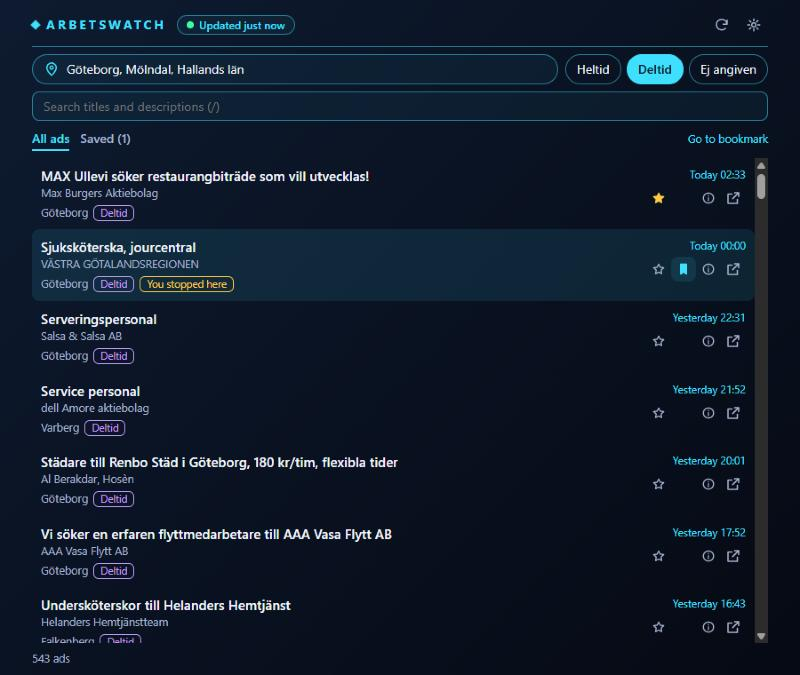

# ArbetsWatch Web

The desktop monitor as a local web app. **It is not hosted and is not ready to be**: it refuses to listen on anything but `127.0.0.1`. The section "Before hosting" lists what would have to change.

```powershell
dotnet run --project src/ArbetsWatch.Web --configuration Release
```



Open <http://localhost:5317>. `ARBETSWATCH_WEB_PORT` picks another port (1024–65535). `ARBETSWATCH_DATA_DIR` moves the data folder, as it does for the desktop app. The port doubles as the single-instance lock: a second copy can't bind it and exits before syncing.

## Design

```text
JobStream / JobSearch / DeepL          (fixed hosts, the server calls them)
        │
ArbetsWatch.Web ── ArbetsWatch.Core    (the same sync, SQLite cache, filters and parsers as the desktop app)
        │  read-only JSON, same origin
Browser: wwwroot                       (filters, read marks, saved ads and bookmark in localStorage)
```

**One sync, one cache.** The server uses Core's `RefreshCoordinator` unchanged, polling every 5 minutes with its own database in `<data folder>\web`, so all the correctness rules in `AGENTS.md` still hold and it can run beside the desktop app.

**Personal state stays in the browser.** The server is a read-only view of public ads, with no accounts, cookies, sessions or state-changing endpoints. That removes whole classes of problem: there is no personal data on the server to leak, nothing for cross-site request forgery to change, and nothing to authorize. Core's server-side `unread` flags are ignored.

**No npm.** Astro was an option but isn't needed: it is one page, and a framework's build chain would add hundreds of third-party packages to a project that is trying to minimize what it trusts. The frontend is plain ES modules served as written, with no install or build step and no third-party code at all. Its logic is tested with Node's built-in test runner.

### Read state in a browser

The same table as the desktop app (AGENTS.md section 6), worked out in the browser from when the server first saw each ad:

| Situation | Result |
|---|---|
| First look, or the server's database was replaced | The baseline: nothing is new. |
| An ad first seen since the last look, matching the filter | Unread, briefly highlighted. |
| An edited ad, or one that starts matching after an edit | Not new: its first sighting is old. |
| The filter changes | Watching restarts from now. Marks stay on ads that remain in the result. |
| Opening an ad | Marks it read. |
| Mark shown as read | Clears the current filter and search result only. |

Each look overlaps the last by a minute, because the server stamps a sighting when its commit starts and it can become visible slightly later. Handled sightings are remembered so a read ad isn't marked again. More than 20,000 sightings in one answer (a very long absence on a wide filter) restarts watching instead of marking everything. Marks older than 90 days are dropped.

## What differs from the desktop app

| Desktop | Web |
|---|---|
| Refresh asks JobStream now | Refresh re-reads the server's cache; the server checks every 5 minutes. There is deliberately no endpoint that makes the server do something. |
| Poll interval, pause | Fixed on the server. |
| Ctrl+F, Ctrl+S, Ctrl+B, Ctrl+D, … | Single keys (`/`, `s`, `b`, `d`, `j`, `k`, `g`, `l`), so browser shortcuts keep working. |
| DeepL key typed into Settings, stored with DPAPI | `ARBETSWATCH_DEEPL_KEY` in the server's environment only. |
| Tray, always on top, transparency, window bounds, in-app updates | Not applicable. |
| Read marks and saved ads in SQLite | In this browser only: another browser starts fresh, and clearing site data removes them. |

## Security

Each row is enforced in code and has tests in `tests/ArbetsWatch.Web.Tests/SecurityTests.cs`, `tests/web/frontend-rules.test.mjs` or `tests/web/logic.test.mjs`. Page behaviour in `app.js` has no automated tests: the rules around it are static checks, and it was exercised by hand in Chromium only.

| Risk | Protection |
|---|---|
| Exposure on the network | One explicit loopback listener. All configuration sources are cleared, so `ASPNETCORE_URLS`, `Kestrel__Endpoints__*`, `ASPNETCORE_PREFERHOSTINGURLS` and an `appsettings.json` beside the binary have no effect. At startup the server stops if any bound address isn't loopback. |
| DNS rebinding from a hostile site | Only the Host names `localhost` and `127.0.0.1` are accepted. |
| Leaking the DeepL key | Read from the environment only and held by the server. No endpoint accepts or returns it; `/api/status` only says whether translation works. The frontend has no key handling at all. Tests assert it is absent from every answer and log under each DeepL outcome. |
| Spending the DeepL quota or upstream requests | Only titles of cached ads can be translated, so it isn't a free translation service. Every API call must carry the page's own `X-ArbetsWatch` header: another site can't send it without a CORS preflight, and preflights are refused. `Sec-Fetch-Site` is checked as well. Upstream-costing calls are rate limited per client address, which on loopback is one shared budget. There is no cap on total DeepL characters. |
| Hostile ad text (cross-site scripting) | All ad text reaches the DOM through `textContent`. The Content-Security-Policy allows only this origin's scripts and styles, with no inline code, and Trusted Types makes markup-writing DOM calls fail. |
| Hostile links in ads | Ad links must be Platsbanken pages. Other links must be http(s) without credentials. E-mail addresses can't carry mailto parameters such as a hidden Bcc. Both are checked on the server and again in the browser. Outgoing links use `noopener noreferrer`. |
| Search words and saved IDs in logs | Framework logging is at Warning and can't be raised from outside, so request URLs are never written. Only a console log exists. |
| Stack traces and internals in errors | The environment is forced to Production, and errors answer with fixed text. |
| SQL and path injection | Every parameter is validated (known places, numeric ad IDs, strict cursors), and SQL is parameterized. Upstream hosts are fixed, and only an ad number can reach an upstream path. |
| Serving private files | Only `wwwroot` is served; the database and binaries live elsewhere. There is no directory browsing. |
| Tampered browser storage | Stored state is rebuilt field by field on load, and anything unexpected falls back to defaults. |
| Supply chain | No npm packages and no third-party origins (tested). The server adds no NuGet package to what Core already uses; versions are locked. |
| Secrets in the repository | `.gitignore` (also `*.pem`, `*.pfx`, `launchSettings.json`), `scripts/check-secrets.ps1` in the pre-commit hook and CI. There are no appsettings or user secrets in this project. |

Known limits:

- Search words, places and saved ad IDs are sent to the server in query strings. On loopback they stay on this PC, are not logged and are `no-store`, but a hosted server would receive them.
- `localStorage` is readable by other software with access to the browser profile, as all browser storage is. It holds preferences and ad IDs, no secrets.
- HTTP without TLS is acceptable only because traffic never leaves the machine.
- Software already running on this PC as another process can call the API on loopback, as it could read the browser profile. The server protects against websites and the network, not local programs.
- A filter change while the server is unreachable restarts watching anyway, so ads that arrived since the last look lose their new marker. They are still listed.
- List rows stay in the page as you scroll (the browser skips rendering those out of view), so scrolling through tens of thousands of ads will use more memory. It is not a recycling list as the desktop app has.

## Before hosting

Not done, on purpose. Each is a decision to make when hosting is on the table.

- [ ] Replace the hard-coded loopback listener and its startup check with an explicit, opt-in setting, and set the allowed Host names to the real domain. `X-ArbetsWatch` stops other sites' pages, not scripts, so it is no substitute for real limits.
- [ ] TLS and HSTS. Terminate at a reverse proxy, and if so, configure forwarded headers precisely, or rate limiting sees one client (the proxy).
- [ ] Decide on the DeepL key. A server-wide key means anonymous visitors spend your quota: put translation behind a login, add a global character budget, or remove it.
- [ ] Decide whether the 450 MB snapshot and search scans can run on the intended host, and add a global limit on concurrent searches.
- [ ] Review what visitors' query strings reveal to the host and its proxy logs, and publish a privacy note (GDPR: IP addresses in logs are personal data).
- [ ] Check JobTech's terms and rate limits for a service used by others, and set a contact in the User-Agent.
- [ ] Run a dependency and container scan in CI, and run the process as an unprivileged user with secrets from a secret manager, not a file.
- [ ] Get an independent security review. The tests here show the listed protections work, not that the list is complete.
